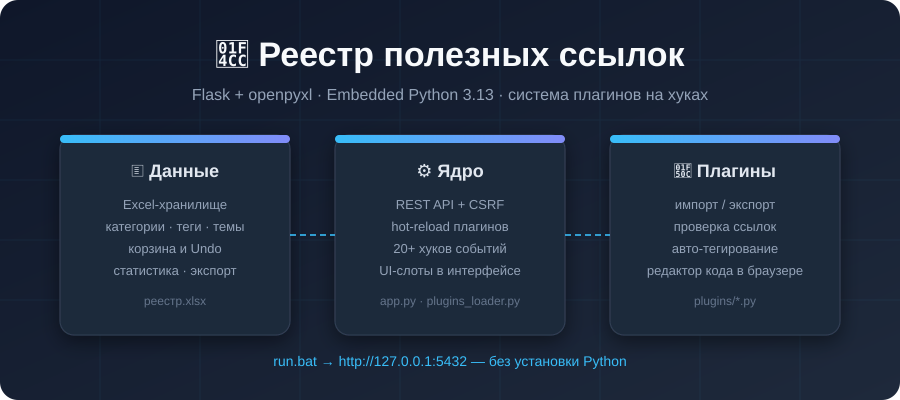

<div align="center">

# 📌 Реестр полезных ссылок



**Локальный веб-реестр ссылок на Flask + openpyxl с системой плагинов и встроенным Python — скачал, запустил `run.bat`, работает.**

[](runtime/embedded/python313)
[](https://flask.palletsprojects.com)
[](#-быстрый-старт)
[](plugins/)
[](#-архитектура)

</div>

---

## ✨ Возможности

| | |
|---|---|
| 🗂 **Excel как БД** | Все данные в `реестр.xlsx` — можно открыть, отредактировать и забрать с собой |
| 🏷 **Категории, теги, группы** | Цвета категорий, иконки групп, drag-and-drop сортировка карточек |
| ⭐ **Избранное и корзина** | Мягкое удаление с восстановлением и автоочисткой через 30 дней, отмена действия (Undo) |
| 🔎 **Поиск и фильтры** | Мгновенный поиск по имени, описанию, тегам; фильтр по категориям и избранным |
| 📊 **Статистика** | Топ категорий, активность, тепловая карта кликов |
| 📤 **Экспорт / импорт** | CSV, JSON, XLSX, HTML; импорт закладок браузера и Pocket |
| 🔌 **Плагины на хуках** | 20+ событийных хуков и UI-слоты — расширяйте интерфейс без правки ядра |
| 🧰 **Редактор кода в браузере** | Создавайте, правьте и проверяйте плагины прямо в UI, с hot-reload |
| 🎨 **Темы оформления** | Встроенные + пользовательские темы, редактируются из интерфейса |
| 🚫 **Без установки Python** | Embedded-рантайм 3.13 лежит в репозитории — проект автономен |

---

## 🚀 Быстрый старт

### Windows (основной сценарий)

```bat
run.bat
```

Откроется **http://127.0.0.1:5432** — ничего устанавливать не нужно:
встроенный Python 3.13 и все зависимости уже лежат в `runtime\embedded\python313`.

<details>
<summary><b>Обновление зависимостей внутри embedded-рантайма</b></summary>

```bat
install_deps.bat   :: требует интернет: скачает pip и пакеты прямо в site-packages рантайма
```

</details>

<details>
<summary><b>Запуск на обычном Python (Linux/macOS или отладка)</b></summary>

```bash
pip install -r requirements.txt
python run_embedded.py     # или python app.py
```

</details>

---

## 🏛 Архитектура

```
┌──────────────────────────────────────────────────────────┐
│  Браузер  ·  static/app.js + темы + UI-слоты плагинов    │
└───────────────────────────┬──────────────────────────────┘
                            │ REST API (CSRF-protected)
┌───────────────────────────┴──────────────────────────────┐
│  app.py  ·  Flask-ядро: записи, категории, корзина,      │
│             статистика, редактор плагинов, темы          │
├──────────────────────────────────────────────────────────┤
│  plugins_loader.py  ·  hot-reload, 20+ хуков, UI-слоты,  │
│                        PluginStorage, изоляция ошибок     │
├───────────────────────────┬──────────────────────────────┤
│  db.py · атомарная        │  plugins/*.py                │
│  запись в реестр.xlsx     │  экспорт/импорт/автотеги/…   │
└───────────────────────────┴──────────────────────────────┘
   runtime/embedded/python313 — Python + Flask + openpyxl внутри папки проекта
```

### Структура проекта

```
.
├── run.bat                  # ← точка входа (embedded Python, без venv)
├── install_deps.bat         # переустановка зависимостей в embedded-рантайм
├── app.py                   # Flask-ядро: маршруты, API, CSRF
├── db.py                    # слой хранения: атомарные операции с реестр.xlsx
├── plugins_loader.py        # загрузчик плагинов: хуки, UI-слоты, hot-reload
├── run_embedded.py          # бутстрап sys.path для стороннего Python
├── requirements.txt         # Flask, openpyxl, markupsafe
├── реестр.xlsx              # база данных (записи + настройки)
├── plugins/                 # 18 готовых плагинов
├── templates/               # Jinja2-интерфейс
├── static/                  # app.js, plugin_runtime.js, themes.css
└── runtime/embedded/python313/   # переносимый Python 3.13 x64 + site-packages
```

---

## 🔌 Система плагинов

Плагин — это обычный `.py` файл в `plugins/`. Ядро вызывает функции-хуки,
если они объявлены:

| Хук | Когда срабатывает |
|---|---|
| `on_startup()` / `on_shutdown()` | старт и остановка сервера |
| `on_add(id, name, link, description, category, tags)` | добавление записи |
| `on_edit(id, …, changes)` / `on_delete(id, …)` | изменение / удаление |
| `on_hard_delete(id, name)` · `on_restore(id, name)` | безвозвратное удаление / восстановление |
| `on_move_to_group` · `on_category_change` · `on_click` | перемещение, смена категории, клик по ссылке |
| `on_import` · `on_bulk_delete` · `on_bulk_move` | импорт и массовые операции |
| `on_status_check_start` / `on_status_check_end` | пакетная проверка ссылок |
| `on_category_rename` · `on_category_delete` · `on_group_rename` | переименования |
| `on_plugins_reload()` | hot-reload плагинов |

UI-слоты (`ui_data_tab`, `ui_tools_tab`, `ui_sidebar`, `ui_modals`,
`ui_scripts`, `ui_styles`, `ui_themes`, …) позволяют плагину добавлять
вкладки, модалки, кнопки и скрипты прямо в интерфейс. Для состояния плагин
использует `PluginStorage` — персистентное хранилище без обращения к Excel.

### Что уже входит в комплект

| Плагин | Описание |
|---|---|
| `export_csv` / `export_json` / `export_xlsx` / `export_html` | Экспорт реестра в CSV, JSON, XLSX и статический HTML |
| `import_xlsx` / `import_bookmarks` / `import_pocket` | Импорт из XLSX, закладок браузера и Pocket |
| `link_checker` | Пакетная проверка доступности ссылок (HEAD-запросы) |
| `autotag` | Авто-тегирование записей по домену ссылки |
| `duplicate_checker` | Поиск дубликатов по URL |
| `trash_soft` | Корзина с восстановлением и автоочисткой (30 дней) |
| `stats_basic` | Статистика: топ категорий, активность, тепловая карта |
| `logger_json` / `example_logger` | Расширенный журнал действий и событий лог + JSONL |
| `themes_builtin` / `themes_user` | Темы оформления и редактор пользовательских тем |
| `example_telegram` | Пример отправки уведомлений в Telegram |

---

## ⚙️ Технологии

| Компонент | Что используется | Зачем |
|---|---|---|
| Язык | **Python 3.13 (embedded)** | Нулевая установка: интерпретатор и библиотеки едут в репозитории |
| Веб-фреймворк | **Flask 3** | Минимальное локальное HTTP-ядро, REST API |
| Хранилище | **openpyxl** | Excel-файл как переносимая человекочитаемая база |
| Frontend | **Vanilla JS + Jinja2** | Без сборщиков и CDN — всё офлайн |
| Безопасность | **CSRF-токены, CORS-allowlist, bind на 127.0.0.1** | Сервер доступен только с локальной машины |

---

## 🛣 API (основное)

| Метод | Путь | Назначение |
|---|---|---|
| `GET` | `/` | Интерфейс реестра |
| `GET` | `/api/bootstrap` | Начальные данные: записи, категории, настройки, UI-слоты |
| `POST` | `/add`, `/edit/<id>`, `/delete/<id>` | CRUD записей |
| `POST` | `/bulk/delete`, `/bulk/move`, `/bulk/tags`, `/bulk/undo` | Массовые операции + отмена |
| `GET/POST` | `/api/plugins/*` | Список, создание, чтение, сохранение, toggle, reload, проверка синтаксиса |
| `GET/POST` | `/api/custom_themes*` | Управление темами |
| `GET` | `/api/storage/info` · `POST /api/storage/migrate` | Состояние и миграция хранилища |

---

## ❓ Частые вопросы

<details>
<summary><b>Нужно ли ставить Python на машину?</b></summary>
Нет. `run.bat` запускает `runtime\embedded\python313\python.exe` — самодостаточный
рантайм со всеми зависимостями. Работает даже на чистом Windows без интернета.
</details>

<details>
<summary><b>Как добавить зависимость для плагина?</b></summary>
Допишите её в <code>plugins_requirements.txt</code> и запустите <code>install_deps.bat</code> —
пакет установится внутрь embedded-рантайма.
</details>

<details>
<summary><b>Плагин упал с ошибкой — уронит ли он приложение?</b></summary>
Нет. Загрузчик изолирует ошибки: битый плагин отключается с понятным сообщением
вкладка «Плагины», остальные работают как ни в чём не бывало. Перед сохранением
через UI код проверяется на синтаксис.
</details>

<details>
<summary><b>Можно ли редактировать Excel руками?</b></summary>
Да, но лучше закрыть реестр в браузере перед правкой: ядро читает файл при
запросах и пишет атомарно (во временный файл + замена).
</details>

---

## 📄 Лицензия

Используйте свободно; распространяйте ответственно.

<div align="center"><sub>Сделано локальным, быстрым и переносимым · <b>run.bat → браузер → готово</b></sub></div>
